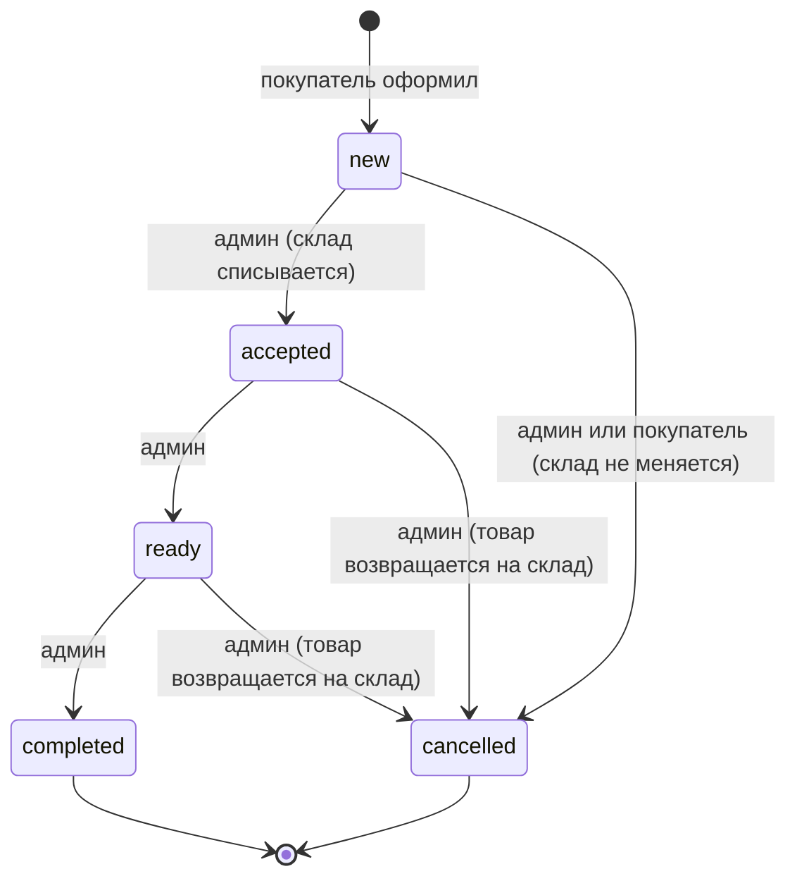
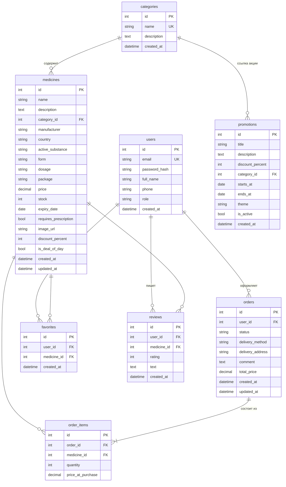

# Darmon — интернет-аптека

Учебный full-stack проект: сайт аптеки в Худжанде с каталогом лекарств, корзиной, оформлением заказа и панелью администратора. Backend на FastAPI с базой SQLite, frontend на React. Всё запускается одной командой в одном Docker-контейнере.

Главная — витрина с акциями, товарами дня и хитами продаж. Каталог устроен как у аптечных маркетплейсов: кнопка «Каталог товаров», строка категорий, фильтры по производителю и форме выпуска, карточки с ценой и кнопкой «Показать аналоги». Администратор после входа сразу попадает в панель управления и может редактировать всё: лекарства, категории, акции, заказы, отзывы и пользователей. При первом запуске база заполняется тестовыми данными: 119 препаратов в 8 категориях, пользователи с таджикскими именами, отзывы и заказы.

### Возможности покупателя
- Регистрация и вход (JWT), личный кабинет с профилем и историей заказов.
- Каталог: поиск по названию и действующему веществу (без учёта регистра, кириллица), фильтры (категория, производители, форма выпуска, цена от/до, только в наличии, без рецепта, со скидкой), сортировка (популярность, новизна, цена, название, скидка), пагинация, «Показать аналоги» (препараты с тем же действующим веществом). Все фильтры сохраняются в URL.
- Страница препарата: описание, характеристики, срок годности, остаток, предупреждение «по рецепту», выбор количества, избранное, отзывы (создать / изменить / удалить свой).
- Корзина в `localStorage` с ограничением по остатку, оформление: самовывоз или доставка (адрес обязателен), комментарий.
- Отмена заказа, пока он в статусе «Новый».
- Акции, «Выгодно сегодня» (товары дня с таймером до полуночи), «Хиты продаж», «Вы уже покупали».

### Возможности администратора (`/admin`)
- Дашборд: новые заказы, выручка (всего и за 30 дней), количество заказов, лекарств и пользователей, топ-5 продаж, «Заканчиваются», «Истекает срок годности».
- Заказы: фильтр по статусу, автообновление каждые 10 секунд, счётчик новых заказов в меню, карточка заказа с данными покупателя, смена статуса кнопками.
- Лекарства: таблица с поиском и фильтром, создание и редактирование всех полей, загрузка картинки, быстрое изменение остатка, удаление, подсветка просроченных и истекающих.
- Категории, акции (баннеры), отзывы (правка и удаление), пользователи (создание, правка ФИО/email/телефона/роли, смена пароля, удаление без заказов), правка способа получения, адреса и комментария заказа.
- На странице препарата администратор видит кнопку «Редактировать препарат». Главная `/` для администратора ведёт в `/admin`. Все удаления — с подтверждением.

## Стек технологий
| Часть | Технологии |
|---|---|
| Backend | Python 3.12, FastAPI, SQLAlchemy 2, Pydantic v2, PyJWT, passlib[bcrypt], python-multipart |
| База данных | SQLite (файл `data/pharmacy.db`) |
| Frontend | React 18, Vite, React Router 6, Axios, React Context, обычный CSS, шрифт Golos Text (локально) |
| Инфраструктура | Docker (multi-stage), docker compose; один контейнер, один порт 8000 |

## Требования
Нужен только **Docker** (Docker Desktop или Docker Engine с Compose v2). Node.js и Python на компьютере не нужны.

## Быстрый запуск
```bash
git clone <repo>
cd pharmacy
docker compose up --build
```

Открыть:
- http://localhost:8000 — сайт
- http://localhost:8000/admin — админ-панель
- http://localhost:8000/docs — Swagger (документация API)

## Тестовые аккаунты
| Роль | Email | Пароль |
|---|---|---|
| Администратор (Ойишабону Солиева) | `admin@pharmacy.local` | `admin123` |
| Покупатель (Мадина Рахимова) | `user@pharmacy.local` | `user123` |
| Другие покупатели | `madina@`, `rustam@`, `nigina@`… `@pharmacy.local` | `user123` |

На странице входа есть кнопки, которые подставляют тестовый аккаунт.

## Полезные команды
```bash
docker compose up -d --build   # запуск в фоне
docker compose logs -f         # логи
docker compose down            # остановка
```

**Сброс базы:** остановите контейнер, удалите `data/pharmacy.db`, запустите заново — тестовые данные создадутся автоматически. То же самое делает `make reset`.

Настройки задаются через `.env` (пример — `.env.example`). У всех переменных есть значения по умолчанию, поэтому проект запускается и без `.env`.

## Локальная разработка без Docker (с hot reload)
Backend (нужен Python 3.12):
```bash
cd backend
python -m venv .venv && source .venv/bin/activate
pip install -r requirements.txt
uvicorn app.main:app --reload
```

Frontend (в другом терминале):
```bash
cd frontend
npm install
npm run dev
```
Сайт откроется на http://localhost:5173, а Vite перенаправит `/api` и `/uploads` на `:8000`.

## Структура проекта
```
pharmacy/
├── backend/
│   ├── app/
│   │   ├── main.py            # приложение, роутеры, статика, SPA fallback, seed при старте
│   │   ├── core/              # config, database, security (bcrypt, JWT), deps (текущий пользователь, роль)
│   │   ├── models/            # SQLAlchemy: users, categories, medicines, orders, order_items,
│   │   │                      #             favorites, reviews, promotions
│   │   ├── schemas/           # Pydantic-схемы запросов и ответов
│   │   ├── routers/           # auth, categories, medicines, favorites, reviews, orders, promotions, admin
│   │   ├── services/          # order_service (статусы и склад), medicine_service (каталог), upload_service
│   │   ├── seed.py            # заполнение БД
│   │   ├── seed_data.py       # 119 препаратов, страны, пользователи, отзывы
│   │   └── seed_photos.py     # ссылки на фото препаратов для seed (сейчас пусто)
│   └── requirements.txt
├── frontend/
│   ├── src/
│   │   ├── api/               # axios-клиент и функции запросов
│   │   ├── context/           # Auth, Cart, Favorites, Toast, Confirm
│   │   ├── components/        # Header, MedicineRow, MedicineCard, StarRating, Badges, CartPanel, ...
│   │   ├── pages/             # Landing, Catalog, Medicine, Cart, Checkout, Favorites, Login, Register,
│   │   │                      # Profile, Orders, OrderDetail
│   │   ├── pages/admin/       # Dashboard, Orders, Medicines, Categories, Promotions, Reviews
│   │   ├── styles/            # base, components, pages, admin
│   │   └── utils/format.js    # formatPrice (сомони), даты, статусы
│   ├── index.html, package.json, vite.config.js
├── data/                      # pharmacy.db и uploads/ (volume, в .gitignore)
├── design/                    # согласованные макеты (HTML + PNG)
├── Dockerfile, docker-compose.yml, .dockerignore, .env.example, .gitignore, Makefile
└── README.md
```

## Жизненный цикл заказа


Правила (`backend/app/services/order_service.py`):
- При создании заказа сервер проверяет остаток (`stock >= quantity`) и срок годности (иначе **409**), фиксирует `price_at_purchase` (цену со скидкой) и сам считает `total_price`.
- При переходе `new → accepted` остатки списываются. Если товара уже не хватает — **409**, статус не меняется.
- При отмене заказа из `accepted` или `ready` товар возвращается на склад, из `new` — склад не трогается.
- Любой другой переход — **400**. Изменения склада и статуса выполняются в одной транзакции.

## Схема БД

Уникальные пары: `favorites(user_id, medicine_id)` и `reviews(user_id, medicine_id)` (один отзыв на препарат от пользователя).

## Изображения препаратов
В тестовых данных у препаратов нет фото — на сайте показывается аккуратная заглушка. Администратор добавляет картинку в разделе «Лекарства» → «Изменить» → «Изображение»: загружает файл (JPG, PNG или WEBP до 5 МБ) или вставляет ссылку. Если ссылка не открывается, тоже показывается заглушка. Фото вписываются в одинаковую белую рамку, поэтому витрина выглядит единообразно.

## Цены и валюта
Все цены — в сомони. Формат «56 смн» или «16,50 смн» задаётся одной функцией `formatPrice()` во frontend. Итоговую цену со скидкой считает сервер.
